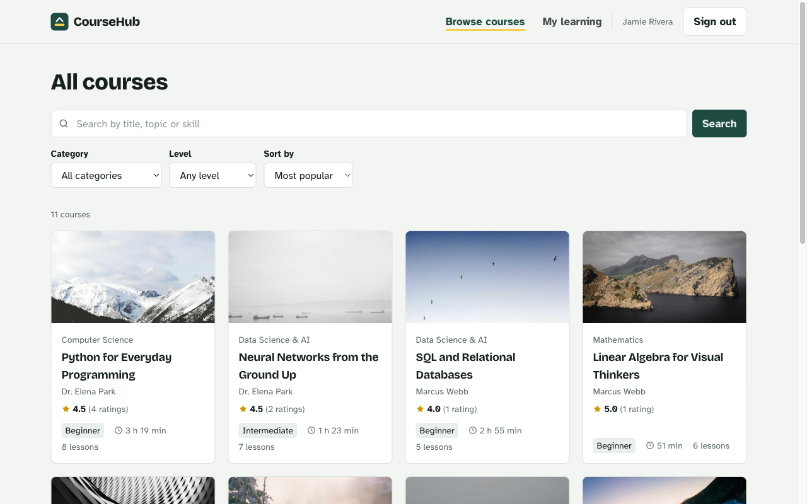
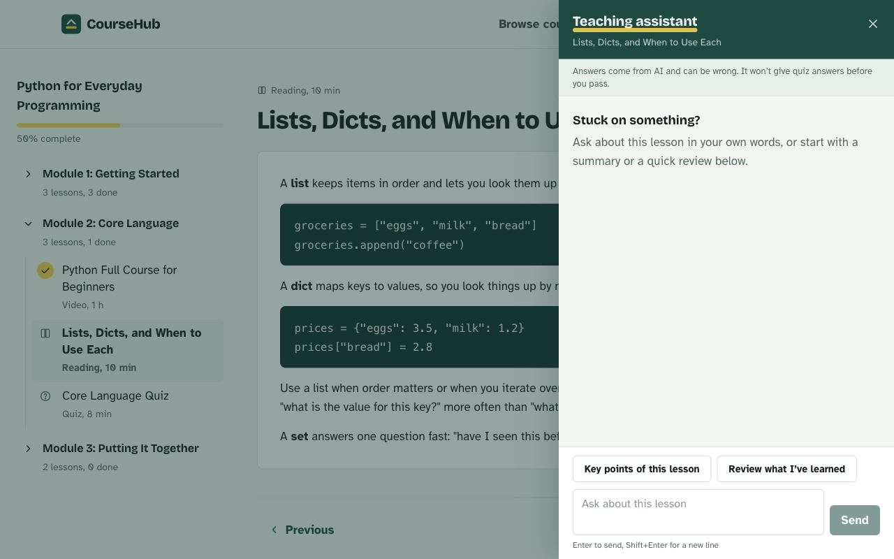
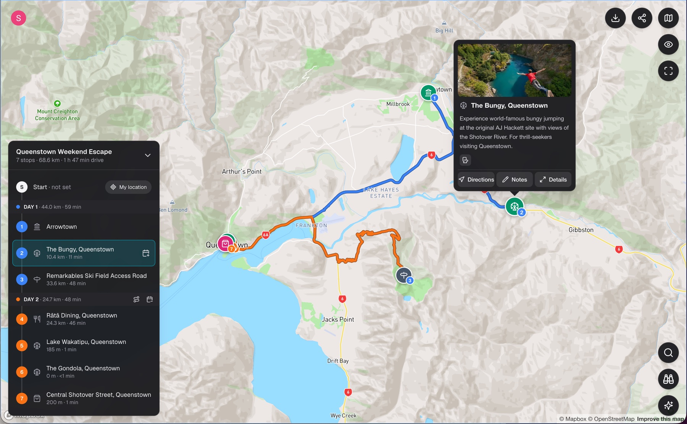
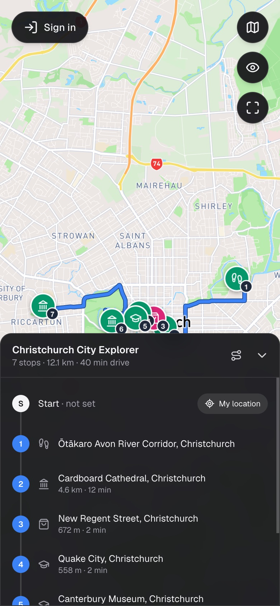

# Shenghua (Woody) Su — Web / Mobile Portfolio

Auckland, New Zealand · [shenghua.su@gmail.com](mailto:shenghua.su@gmail.com) · GitHub [@sushenghua](https://github.com/sushenghua)

Web and mobile apps in TypeScript: React, Next.js, Tailwind, Capacitor and React Native, with Node.js and Python (FastAPI) back ends and LLM features. Each project links to its repo or live site. My embedded firmware work is on the [embedded page](EMBEDDED.md), and the [index](README.md) lists both.

## Skills

| Area | What |
|---|---|
| Frontend | TypeScript, JavaScript, React, Next.js, HTML5, CSS3, Tailwind CSS |
| Mobile | Capacitor (iOS / Android), React Native + Expo (dev client, EAS) |
| UI engineering | Design systems, component libraries, accessible and responsive UI, form validation (Zod) |
| State and data | React Query, Zustand, D3.js, Mapbox GL JS, MapLibre, React Flow |
| Testing and QA | Vitest unit tests with CI coverage gates, fast-check property-based tests, MSW request mocking, Playwright E2E, Lighthouse performance audits |
| AI features | Claude API tool use with prompt caching, OpenAI-compatible adapters, MCP servers (Streamable HTTP), vision analysis of photos, SQLite FTS5 retrieval |
| AI-assisted development | Claude Code and other AI coding assistants for project planning, iterative development, automated testing, issue tracking, and CI/CD integration |
| Backend and APIs | Node.js, Python (FastAPI), RESTful APIs, GraphQL, JWT and session authentication, API contract design |
| Data | MySQL, PostgreSQL + PostGIS, MongoDB, Redis, SQLite; schema design, indexing, aggregation |
| Cloud and DevOps | AWS (EC2, VPC, ALB, RDS, CloudFormation), Docker, CI/CD, Git, Linux |

---

## Projects

### [`GardenAI`](https://github.com/sushenghua/GardenAI) — app and assistant

  
  
  

React + TypeScript app (Capacitor for iOS): readings and charts, strategy editor, Bluetooth node setup, firmware releases. The assistant (Claude by default, other providers through adapters) reads the garden through tools, also served over MCP. Memory is an LLM wiki of markdown notes it keeps between conversations, plus RAG over uploaded gardening guides (SQLite FTS5, cited by page). Guardrails: it can only propose changes the gardener approves, limits are enforced in code rather than the prompt, it is never in the node's watering decision, and guide text is treated as data, not instructions.

### CourseHub — [coursehub-two-pi.vercel.app](https://coursehub-two-pi.vercel.app/)

  
  

An online course site following mainstream online learning platforms. Learners take video, reading, and quiz lessons, track progress, and earn certificates. Instructors write and publish courses. An AI teaching assistant on each lesson answers from the course material and only hints on quizzes the learner hasn't passed. React + TypeScript, FastAPI, PostgreSQL. Sign in with `learner@example.com` or `instructor@example.com`, password `password123`.

### [`RoamoodDemo`](https://github.com/sushenghua/RoamoodDemo) — mobile app

  
  
  

React Native + TypeScript app for the Roamood device, built with an Expo custom dev client and EAS. It generates stems with cloud AI, currently Stable Audio 2 behind a provider interface, arranges them on a timeline with effects and time-stretch, and pushes them to the device. The audio engine is Superpowered C++ in a local Expo module driven over JSI, so control values skip the JS bridge and no audio samples cross it. It runs the same effect chain and beat clock as the firmware. BLE for control, HTTP over WiFi or the device's own access point for stem transfer. Jest for DSP and format logic, C++ host tests on macOS. The repo README embeds a walkthrough video.

### [`InternetConnectionControlDemo`](https://github.com/sushenghua/InternetConnectionControlDemo) — web console and mobile app

  
  

A self-hosted Next.js parental-control console and a Capacitor companion app (iOS so far), paired with the ESP32-C6 firmware on the [embedded page](EMBEDDED.md#internetconnectioncontroldemo--firmware). The console has a router client interface with UniFi and Asus implementations, cookie-session auth with router credentials stored encrypted, and a device matcher that scores hostname, OUI, and vendor so a device keeps its identity when its MAC address changes. The repo holds screenshots of both apps.

### Western Corridor Urban Mining — [live page](https://sushenghua.github.io/BrownyHackathonUrbanMining/)

  

Built in one day at the Auckland CivicTech Hackathon (October 2026) for Auckland Council's construction and demolition waste challenge. I worked as a full-stack developer in a team of 6. Houses along the Western Rail Corridor hold reusable timber, roofing, bricks, metals, doors and windows, but nobody could see how much or where, so most of it ends up as waste. The Materials Explorer lets Council and recovery operators pick a station catchment, local board or ward and see expected recoverable materials (reuse vs recycling) and an indicative value, then zoom in to any house. Every figure is also served as JSON / GeoJSON. Next.js, TypeScript, Tailwind, MapLibre, FastAPI, PostgreSQL + PostGIS, Docker. The [repo](https://github.com/sushenghua/BrownyHackathonUrbanMining) holds the project page and demo video.

### Trip Planner Map — [trip-planner-map.vercel.app](https://trip-planner-map.vercel.app)

  
  

Next.js, Mapbox GL JS, MongoDB, React Query, Zustand. Add stops, see the route, and on a phone the trip list becomes a bottom sheet. AI trip suggestions are available after sign-in.

### Student Grade Analysis (SGA) — [usgaweb.vercel.app/students](https://usgaweb.vercel.app/students)

  

Grade and programme management for a graduate ICT school. Sign in with user `admin`, password `admin` to browse about 250 sample students, filtered by programme, term, course, or tag. Next.js front end, FastAPI + Pandas + MySQL back end, deployed with Docker on AWS EC2.

<!-- TODO image: desktop screenshot of the students table signed in as the demo account (sample data, no real names), about 1200 px wide, saved as images/sga-students.png in this repo. -->

### [`application_ui`](https://github.com/sushenghua/application_ui)

  
  

Screenshots from apps I have built: Roamood, the parental-control console, the CoolingDock app, the trip planner, the grade analysis site, a DEX trading front end, and some older native work (an iOS game in Cocos2d, shown as a video, and an Android battery app).

### Other web / mobile work

- [`CryptoPortfolioDemo`](https://github.com/sushenghua/CryptoPortfolioDemo/blob/main/binance_crypto.ipynb) — Python notebook (NumPy, Pandas, SciPy, Seaborn) that pulls Binance price history and computes returns, volatility, Sharpe ratio, VaR, and efficient-frontier portfolios, with charts rendered in the notebook. Needs a Binance API key to re-run.
- **CryptoBot** (remote contract, 2025) — market-analysis assistant. Next.js + Zustand front end on a FastAPI + CrewAI back end.
- **Cryptocurrency DEX** at Hoo Smart Chain (2022 to 2023) — trading interface in React, Ethers.js, Tailwind, and Node.js, with order placement, order books, and portfolio views. One screen is in [`application_ui`](https://github.com/sushenghua/application_ui#dex-frontend-complex-web-ui).

---

## Contact

- **Email** [shenghua.su@gmail.com](mailto:shenghua.su@gmail.com)
- **GitHub** [@sushenghua](https://github.com/sushenghua)
